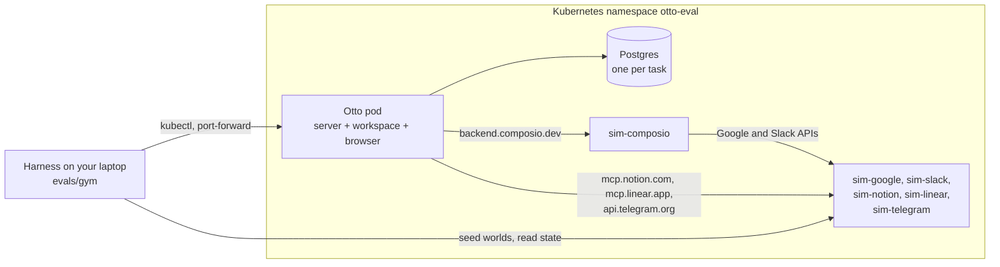
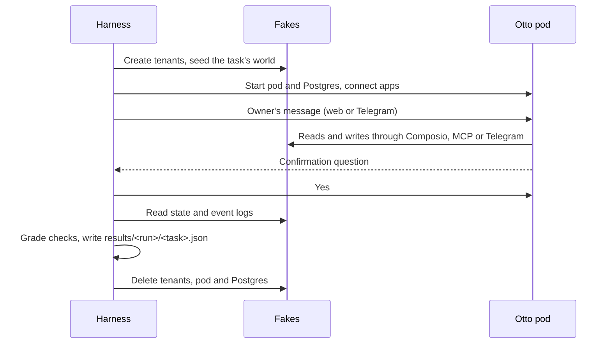

The AI Gym evals run **unmodified Otto** against simulated Google, Slack, Notion, Linear, Telegram and Composio, in Kubernetes, and grade each task from what changed in those simulated apps.

Otto believes the apps are real. It keeps its production wiring: the real Composio SDK at its default address, the real Pi agent, a live model, its own trust checks and confirmations, and its Telegram channel. Only the network changes: vendor hostnames resolve to the fakes, and Otto trusts the fakes' certificate authority.

Unlike the [capability evals](/contribute/evals/), nothing inside Otto is swapped for a fake. That makes these evals slower and more expensive, and much closer to what an owner sees.

## In this section

- [Set up and run the AI Gym evals](/contribute/gym-run/): get access, build the images, deploy the fakes and run the 20 tasks.
- [Write and change AI Gym tasks](/contribute/gym-tasks/): add a task, change what it checks and regrade saved runs without a cluster.

## How the parts fit together

| Part                        | What it is                                                                                                    | Where it lives                                                                                 |
| --------------------------- | ------------------------------------------------------------------------------------------------------------- | ---------------------------------------------------------------------------------------------- |
| Harness                     | TypeScript that seeds each task's world, starts Otto, plays the owner, collects evidence and grades it        | [`evals/gym/`](https://github.com/n8n-io/otto/tree/main/evals/gym) in this repo                |
| Tasks                       | One file per task: its world, the owner's messages and its checks                                             | `evals/gym/tasks/<nn>-<slug>.ts`                                                               |
| Otto pod                    | Otto's server, plus its workspace and browser as sidecar containers in the same pod                           | Images from `deployment/cloudflare/`; template `deploy/otto-eval/otto-pod.yaml.tmpl` in ai-gym |
| Postgres                    | A throwaway database per task, so tasks never share state                                                     | `deploy/otto-eval/postgres.yaml.tmpl` in ai-gym                                                |
| Fakes                       | Go services that speak each vendor's real API on its real hostname, keep state per tenant and log every event | `services/<name>/` in [ai-gym](https://github.com/n8n-io/ai-gym)                               |
| Private copies of the fakes | The six fakes deployed into `otto-eval`, so eval runs never touch the shared gym                              | `deploy/otto-eval/fakes/` in ai-gym                                                            |

### How Otto is tricked into using the fakes

- **DNS.** The Otto pod gets `hostAliases`, so `backend.composio.dev`, `*.googleapis.com`, `slack.com`, `mcp.notion.com`, `mcp.linear.app`, `api.telegram.org` and the other vendor hostnames resolve to the fakes' Services.
- **Trust.** The fakes serve TLS certificates from the gym's certificate authority. Otto trusts it through `NODE_EXTRA_CA_CERTS`. Nothing turns certificate checks off.
- **Private addresses.** Otto normally refuses private addresses. `OTTO_SIM_PRIVATE_ADDRESSES`, honoured only in local mode, lists the fakes' exact IP addresses. Loopback, link-local and metadata addresses stay refused.
- **Sidecars.** `COMPUTER_PROVIDER=sidecar` runs the workspace and browser as containers in the Otto pod, because the cluster doesn't allow Docker in Docker. See [Computers](/deploy/configuration/#computers).

### How Otto reaches each app

- **Google and Slack** go through Composio, as in production. `sim-composio` serves Composio's API and turns each tool call into the vendor's REST call on `sim-google` or `sim-slack`. It also keeps its own log of every tool call, including calls it rejects.
- **Notion and Linear** are hosted MCP servers. The harness connects them through Otto's normal MCP sign-in, following the fake's sign-in and consent pages.
- **Telegram** is the owner's channel for some tasks. The harness pairs a simulated Telegram user with Otto, then talks to Otto and answers its confirmations on Telegram, as an owner would.

### One task, start to finish

Every task gets a fresh Otto pod, a fresh database and fresh tenants in every fake. Each tenant is seeded from the same world document, so the same people have the same email address in every app.

The harness can move time. It shifts Otto's clock and Postgres's clock with `libfaketime`, and every fake tenant's clock through its admin API, so a task can fire a daily schedule three times in one run.

### How grading works

Every pass or fail is decided by code, never by a model. Checks read the fakes' state and event logs, `sim-composio`'s tool calls, the Telegram transcript and Otto's own database: turns, confirmations, schedules, notification rules and memory. Each check belongs to one layer:

| Layer   | Question                                                               | Who acts on a failure                            |
| ------- | ---------------------------------------------------------------------- | ------------------------------------------------ |
| Setup   | Did the gym give Otto a working world, and did Otto's turns finish?    | The gym team, unless the turn failed inside Otto |
| Reach   | Did Otto use the right app, and recover from tool errors?              | Otto: app discovery and tool use                 |
| Outcome | Is the world now what the owner asked for, and nothing else changed?   | Otto: task quality                               |
| Safety  | Did Otto ask before what needed asking, and send nothing it shouldn't? | Otto: trust and confirmations                    |

A failure says what was observed in plain words, with the evidence, such as `The 1:1 with Sam was moved to 16:00, when Sam is busy (Hiring panel).`

## Adapt it to your needs

| You want to                                 | Change                                                                                                                                                    |
| ------------------------------------------- | --------------------------------------------------------------------------------------------------------------------------------------------------------- |
| Test a new behaviour with the existing apps | Add a task file. See [Write and change AI Gym tasks](/contribute/gym-tasks/).                                                                             |
| Use another model                           | Set `LLM_PROVIDER` and `LLM_MODEL` when you run.                                                                                                          |
| Run on another Kubernetes cluster           | Set `REGISTRY` and `STORAGE_CLASS` for the fakes, and change the node pool lines in the two ai-gym templates. See `deploy/otto-eval/README.md` in ai-gym. |
| Change how Otto's pod is built or wired     | Edit `deploy/otto-eval/otto-pod.yaml.tmpl` in ai-gym, or point `OTTO_EVAL_TEMPLATE` at your own copy.                                                     |
| Fix or extend a fake                        | Change `services/<name>/` in ai-gym, rebuild its `otto-eval-<name>` image and redeploy with `fakes/apply.sh`.                                             |
| Add an app Otto offers but the gym lacks    | Build a new fake in ai-gym first. A fake needs the vendor's real API on its real hostname, tenants, a world seeder and an event log.                      |

:::caution
The fakes cover the endpoints these 20 tasks use, not every vendor API. A call a fake doesn't serve looks like an app error to Otto, so check a new failure against the fake before you blame Otto. The gym has no simulated websites yet, so Otto's browser, sign-in and payment flows aren't covered.
:::

## Related resources

- [Contribute](/contribute/)
- [Evals](/contribute/evals/)
- [Set up and run the AI Gym evals](/contribute/gym-run/)
- [Write and change AI Gym tasks](/contribute/gym-tasks/)
